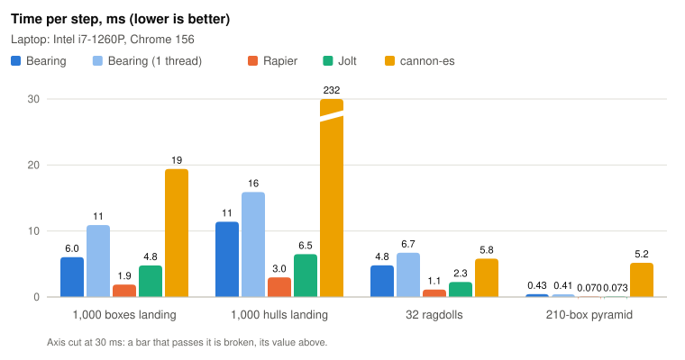

<picture>
  <source media="(prefers-color-scheme: dark)" srcset="docs/wordmark-dark.svg">
  
</picture>

[](https://github.com/getlowarc/bearing/actions/workflows/ci.yml)
[](https://www.npmjs.com/package/bearing-physics)
[](docs/API.md)
[](LICENSE)

A 3D physics engine in plain JavaScript, for any renderer. No dependencies, no build step — ES
modules, used as they are.

Bearing simulates rigid bodies: boxes, balls, capsules, convex hulls and compounds of them, on
level geometry of triangle meshes and heightfields, held by joints, with a character body for the
player and raycasts for everything else. It is plain JavaScript rather than WebAssembly, so the
files you import are the files in this repository, readable and steppable in a debugger, and it
runs wherever JavaScript does: browsers, Node, Deno, Bun and workers. The same inputs give the same
results to the bit on every machine, which replays, tests and lockstep multiplayer need. It draws
nothing and imports nothing from any engine: Three.js, Babylon.js, PlayCanvas, Pixi and Winding
read its results the same way. Its API is stable through 1.x (see [What 1.x promises](docs/API.md#promises)), and it is slower than
the WebAssembly engines; see [How it compares](#how-it-compares) and
[Limitations](#limitations).

```js
import { World } from 'bearing-physics';

const world = new World();
world.addBody({ type: 'static', size: [20, 1, 20], position: [0, -0.5, 0] });
world.addBody({ shape: 'sphere', position: [0, 4, 0], restitution: 0.7 });

function update(dt) {   // your loop's fixed step, such as 1 / 60 s
  world.step(dt);
}
```

That is the whole setup: the ball falls, bounces lower each time, and rests on the ground. There is
no `init()`, no broadphase to choose, no mass to work out (it comes from the shape and water's
density unless you give one), no tolerances to tune, and nothing to size in advance.

**Every call, option and setting is in the [API reference](docs/API.md)**: what it does, what it
takes, what it returns and what it throws, with an index to look any of them up by name.

## What it does

In three dimensions, as below, and in two: [`bearing-physics/2d`](docs/API-2D.md) has the same calls
in pixels with y down, for boxes, circles, capsules, polygons and compounds on tilemaps you can
mine as the game runs, and characters that walk on them.

- **Bodies**: dynamic, static, kinematic and character; boxes, spheres, capsules, convex hulls and
  compounds, with mass, inertia and centre of mass worked out from the shape. Forces, torques and
  impulses, damping, gravity scale and rotation locks. A lopsided body tumbles as a real one does,
  keeping its angular momentum exactly.
- **Contacts**: exact contact points for every pair of shapes, friction that holds a box on a slope
  until it is steep enough to slide, bounces that settle, and stacks that stand: a 210-box pyramid
  stands on the defaults within a tenth of a millimetre of where it was built. Every tolerance
  comes from the size of what touches, so a 1 cm marble and a 50 m building behave with nothing
  retuned. See [Contacts](docs/API.md#contacts).
- **Fast bodies stop.** A 1 cm ball at 500 m/s stops on a 1 cm wall, with nothing to switch on.
- **Thousands of bodies**: only bodies whose boxes overlap are tested; 32 collision layers, with a
  mask per body, say what collides with what; and a contact that has hardly changed since the last
  step is kept rather than found again. See [Layers, masks and groups](docs/API.md#layers).
- **Sleeping**: a heap at rest goes to sleep and costs nothing until something disturbs it, which
  wakes it with nothing to call. Part of a heap that has stopped is frozen while the rest of it
  still settles. [`world.moved()`](docs/API.md#world-moved) lists only the bodies a renderer has
  to draw again. See [Sleeping](docs/API.md#sleeping).
- **Queries**: raycasts (nearest, or every hit), shape casts and overlap tests, exact for every
  shape. See [Queries](docs/API.md#queries).
- **Level geometry**: triangle meshes and heightfields with no seams to catch on, and meshes read
  straight from a `.glb` file with [`readGlb`](docs/API.md#readglb). See
  [Meshes and heightfields](docs/API.md#meshes).
- **Character bodies**: a body the game gives a velocity to, that walks rather than flies: it
  slides along walls, walks up slopes and stairs to a limit, stays on the ground going down, and
  rides moving platforms. See [Character bodies](docs/API.md#characters).
- **Joints**: fixed, ball, hinge, slider, distance, rotation and wheel joints, with stops, motors,
  springs and friction. A wheel joint is a car's wheel on its suspension, driven, braked and steered. A motor can drive to a target angle, position or orientation, as a spring
  solved inside the step, so a ragdoll with its joints driven to a pose stands on its own feet.
  Chains, ragdolls and bridges are solved exactly, so a 100-link chain hangs at its built length.
  Each joint's force and torque over the last step can be read, to break it. See
  [Joints](docs/API.md#joints).
- **Contact events and sensors**: which bodies began and stopped touching in each step, where and
  how hard, read after the step; what touches a body now; and sensors, zones that report what
  enters them and push nothing. See [Contact events and sensors](docs/API.md#events).
- **Cylinders**: wheels, logs and barrels, round one way and flat the other, rolling on their
  side and standing on their ends, on any ground. See [Cylinders](docs/API.md#cylinders).
- **Pieces**: `fracture()` cuts a box or a hull into pieces that fill it exactly, the same for a
  seed on every machine, for things that break. See [Pieces](docs/API.md#pieces).
- **Soft bodies**: cloth, flags and sails, and closed shapes that keep their volume, colliding
  with every rigid body both ways, pushed by the wind, pinned to bodies or the world, and drawn
  from one array of their corners. See [Soft bodies](docs/API.md#soft-bodies).
- **Water**: boxes of water that hold up what is in them as Archimedes says, at the centre of
  the part under the surface, so planks float flat and rafts drift on a current. See
  [Water](docs/API.md#water).
- **Save and load**: [`world.save()`](docs/API.md#world-save) gives the whole world as plain data,
  and [`World.load`](docs/API.md#world-load) steps on from it exactly, for replays, checkpoints
  and bug reports that reproduce. [`world.debugLines()`](docs/API.md#world-debuglines) gives the
  world as line segments for any engine to draw.
- **Workers**: a world shares its contacts and joints with threads of its own once it has enough
  of them to be worth it, with results identical to the bit to one thread's. Nothing to set up.
  See [`world.workers`](docs/API.md#world-workers).

## How it compares

<picture>
  <source media="(prefers-color-scheme: dark)" srcset="docs/images/compare-dark.svg">
  
</picture>

The same scenes through Bearing, Rapier, Jolt and cannon-es, in one page, taking turns. Bearing
holds stacks tightest of the four, casts rays faster than Jolt and cannon-es, and with its workers
is faster than cannon-es on every scene. It is slower than Rapier on every scene, from 1.2 times
on the stack (on one thread) to 6.8 times on the hull pile once it has landed, and slowest
against Rapier and Jolt on scenes that have settled, which they put to sleep sooner.

<!-- TODO(lead): add the Ryzen 5 5500 desktop's run when there is one. -->

| Laptop, ms a step unless said | Bearing | Bearing, 1 thread | Rapier | Jolt | cannon-es |
|---|---|---|---|---|---|
| 10-box stack, 10 s | 0.0123 | 0.0111 | 0.00922 | 0.00236 | 0.0887 |
| …how far a box strayed | 0.00 mm | 0.00 mm | 9.54 mm | 20.0 mm | fell |
| 210-box pyramid, 10 s | 0.433 | 0.412 | 0.0700 | 0.0726 | 5.18 |
| …how far a box strayed | 0.08 mm | 0.08 mm | 11.1 mm | 6.38 mm | fell |
| 1,000-box pile, 0–5 s | 6.04 | 10.9 | 1.88 | 4.78 | 19.4 |
| 1,000-box pile, 5–10 s | 4.62 | 8.40 | 1.20 | 4.46 | 21.7 |
| 1,000-hull pile, 5–10 s | 1.56 | 1.86 | 0.230 | 0.291 | 338 |
| 10,000-box pile, 0–1 s | 30.9 | 48.8 | 13.8 | 24.2 | — |
| 10,000 rays into 1,000 boxes, ms for all | 33.8 | 30.7 | 17.1 | 239 | 462 |
| 32 ragdolls, 0–4 s | 4.80 | 6.71 | 1.13 | 2.27 | 5.81 |
| 32 ragdolls, 4–8 s | 3.18 | 5.46 | 0.952 | 0.00158 | 4.97 |
| …widest joint gap at 8 s | 0.00 mm | 0.00 mm | 7.08 mm | 0.10 mm | 5.25 mm |

Where Bearing is ahead:

- **Stacks.** Its 10-box stack strayed 0.00 mm in 10 s and sank 6.57 mm, against 9.54 and
  23.9 mm in Rapier and 20.0 and 13.1 mm in Jolt; its pyramid strayed 0.08 mm against 6 to 11.
  cannon-es's stack and pyramid fell.
- **Rays.** 10,000 rays in 30.7 ms on one thread: 7.8 times faster than Jolt and 15 times faster
  than cannon-es, though 1.8 times Rapier's 17.1 ms.
- **Joints held shut.** The ragdolls' widest joint gap was 0.00 mm, against 0.10 mm in Jolt and
  5 to 7 mm in cannon-es and Rapier.
- **Against cannon-es**, the other engine in plain JavaScript: faster on every scene with
  workers, 3.2 to 200 times on the piles and the pyramid. On one thread, cannon-es is still 1.10
  to 1.15 times faster on the ragdolls, holding their joints far looser.
- **The same bits everywhere, and no WebAssembly**: see [Determinism](#determinism).

Where it is behind:

- **Settled scenes.** Rapier and Jolt put the pyramid, the hull pile and the ragdolls to sleep
  sooner, and Bearing goes on solving them: its pyramid costs 6 times Rapier's and Jolt's, its
  hull pile 7 times Rapier's once landed, and at 10 s Rapier had all 1,000 boxes of the pile
  asleep, Bearing 101. Its sleep rule is stricter by design: a body sleeps only once no point of
  it has strayed more than about a pixel in any second for a second
  ([Sleeping](docs/API.md#sleeping)).
- **Ragdolls.** Rapier stepped the 32 ragdolls 3.3 to 4.2 times faster than Bearing with workers;
  Jolt put all of them to sleep by 8 s, Bearing 66 of 352 parts. Here the joints are frictionless,
  and a limb left hanging swings on in Bearing, as an ideal hinge does, keeping its heap awake;
  Jolt's solver loses that energy. Give the joints some `frictionForce` and they settle.
- **Busy piles.** As 1,000 boxes land, Rapier steps them 3.2 times faster than Bearing with
  workers and Jolt 1.26 times (4.78 ms against 6.04); 10,000 boxes, 2.2 and 1.3 times.
- **Small worlds with workers.** Waking threads costs more than a 10-box stack saves: 0.0123 ms a
  step with workers against 0.0111 on one thread.

<sub>Laptop: Intel i7-1260P with Iris Xe, on the charger, Chrome 156, 2026-11-11, Bearing at commit
`b500ef3`; the Ryzen 5 5500 desktop is still to be run. Each number is the median of 3 runs, the
engines taking turns in blocks of 10 steps, each timed on its own `step()` call alone, the first
block a warm-up. Rapier 0.21.0 (its SIMD build), Jolt 1.1.0 (single-threaded), cannon-es 0.20.0
(given its sweep-and-prune broadphase and sleeping, as its docs advise for many bodies), and
Bearing with workers (`'auto'`, 7 on this machine, on a cross-origin isolated page) and on one
thread. Matched: 1 m boxes of 1,000 kg, friction 0.5, restitution 0, steps of 1/60 s, the same
starting places. Not matched: each engine's own solver settings, sleep rules and margins.
"Strayed" is the furthest any box ended sideways from where it was built, and a stack "fell" unless
every box ended within 10 cm of it. The 10,000-box pile is run without cannon-es, which lost the
page on it. Every result, the earlier run, and how to run the page, `bench/compare.html`,
yourself, are in [bench/RESULTS.md](bench/RESULTS.md).</sub>

**The code, side by side.** [Hello world, side by side](docs/SIDE-BY-SIDE.md) has the same small
program in Bearing, Rapier, cannon-es and Jolt: a floor, a box dropped on it and a ball rolled into
it. It also lists what each engine asked for that Bearing works out for itself.

## Install

There is no build step and there are no dependencies, so a URL is the whole install. The files you
import are the files in this repository.

**From a CDN**, which needs nothing installed at all:

```html
<script type="module">
  import { World } from 'https://cdn.jsdelivr.net/npm/bearing-physics@1.5.1/src/bearing.js';
</script>
```

**From npm**, if you have a bundler or an import map:

```bash
npm install bearing-physics
```

```js
import { World } from 'bearing-physics';
```

**As an import map**, which gets you bare specifiers with no bundler and no install:

```html
<script type="importmap">
{
  "imports": {
    "bearing-physics": "https://cdn.jsdelivr.net/npm/bearing-physics@1.5.1/src/bearing.js",
    "bearing-physics/2d": "https://cdn.jsdelivr.net/npm/bearing-physics@1.5.1/src/2d/bearing2d.js",
    "bearing-physics/": "https://cdn.jsdelivr.net/npm/bearing-physics@1.5.1/src/"
  }
}
</script>
```

**Pin it.** A URL without a version can change under you, so code you have never seen
can change what your page runs, and two machines that must agree to the bit (see
[Determinism](#determinism)) can end up running different versions.

**TypeScript** needs nothing more: the package ships its types (`src/bearing.d.ts`), written by
hand beside the JavaScript and checked in CI, and they give plain-JavaScript editors completion
and hover help too.

**The lower levels come with it.** Every module is reachable by path, `bearing-physics/<file>.js`,
as Winding's are: there is no wall, only a floor. Only `World`, `Body`, `Joint` and `readGlb` are
the documented API, so what lies below can change in any version.

**Workers need a cross-origin isolated page.** Bearing's workers share memory with the page, which
a browser allows only on a page served with `Cross-Origin-Opener-Policy: same-origin` and
`Cross-Origin-Embedder-Policy: require-corp`; in Electron, the app has to set the same headers on
its pages. Without them a world runs on one thread, with the same results and nothing to change.
Loaded from a CDN, Bearing starts its workers through a one-line module of the page's own, since a
browser won't start a worker from another origin. On an isolated page, every script from another
origin, Bearing's included, has to be served with CORS or a `Cross-Origin-Resource-Policy` that
allows it; if your CDN's isn't, serve Bearing from your own origin. In Node, workers need Node
20.16, 22.3 or newer; earlier versions run on one thread.

## Determinism

The same calls, with the same arguments, in the same order, give the same results to the bit: on
any CPU, in any browser, in Node, Deno or Bun, and with any number of workers or none. It holds
because JavaScript defines `+`, `-`, `*`, `/` and `Math.sqrt` exactly, and Bearing never calls the
functions each JavaScript engine may round its own way, such as `Math.sin` and `Math.atan2`: where
it needs an angle, it uses its own sine, cosine and arctangent, built from the exact operations.

Four tests hold it: `test/math.test.js` fails if anything in `src/` calls one of those
functions; `test/determinism.test.js` steps a world of every feature for 10 s and checks a hash of
every body's state against the one it stores, and CI runs it on Bun (JavaScriptCore) as well as
Node (V8); `test/workers.test.js` steps such a world, and standing ragdolls, with 0, 2 and 4
workers and checks the bits match; and `test/save.test.js` saves such a world mid-run, loads it,
and checks that 600 more steps match the original's to the bit. Different versions of Bearing may give different results, so pin
the version on every machine that has to agree. See [Determinism](docs/API.md#determinism).

## Any renderer

Bearing knows nothing about drawing. After each step, every body's position and rotation is in one
`Float32Array`, [`world.transforms`](docs/API.md#world-transforms), 7 numbers a body, so any
engine copies them in one loop. [`world.previous`](docs/API.md#world-previous) holds the step
before, for drawing smooth motion between fixed steps, and
[`world.moved()`](docs/API.md#world-moved) says which bodies changed since a frame was last drawn,
so only those are copied. [Engines](docs/ENGINES.md) shows that loop for Three.js, Babylon.js,
PlayCanvas, Pixi and Winding.

## Limitations

- **Stable, not frozen.** Through 1.x, code written against the [API reference](docs/API.md) keeps
  working; results, measured figures and error wording may still change between versions (see
  [What 1.x promises](docs/API.md#promises)).
- **The [2D module](docs/API-2D.md) has less in it than 3D:** no joints, save and load, debug lines
  or workers yet, and it isn't in [How it compares](#how-it-compares). It has no continuous
  collision of its own: contacts look ahead along a body's motion, which stops a ball on a thin wall
  or tile at 100,000 px/s, but a thin body spinning fast isn't swept as in 3D.
- **Rigid bodies only.** No soft bodies, cloth or fluids. No vehicle or ragdoll builder: a car or a
  ragdoll is bodies and joints put together by your own code.
- **Meshes and heightfields are static or kinematic.** Triangles enclose no volume, so they have
  no mass to fall with; a falling object of any shape is a hull, or a compound of hulls.
- **Hulls and compounds can't be characters or query shapes.** Shape casts and overlap tests take
  a box, a ball or a capsule.
- **Slower than Rapier on every scene, and than Jolt on all but the rays.** Both are compiled to
  WebAssembly. Bearing is slowest against them on scenes that have settled; see
  [How it compares](#how-it-compares).
- **Workers need a cross-origin isolated page** in a browser (see [Install](#install)), and on
  small worlds they cost more than they save.
- **Characters are built for tens or hundreds**, not thousands: each casts its shape through the
  world a few times a step.
- **A sensor doesn't see a body that passes all the way through it within one step**: sensors are
  checked where a step leaves bodies.
- **Saved data belongs to its version.** [`world.save()`](docs/API.md#world-save) follows Bearing's
  own layout, so it is stamped with the version that saved it and loads only into that version,
  and it is large: a settled heap of 1,000 boxes is about 7 MB of JSON.

## Demo

```bash
node serve.js
```

Then open <http://localhost:8080/demo/>: a 210-box pyramid, a stack, bouncing balls, boxes on
slopes either side of their friction, a moving platform, a mixed pile, 2,000 balls raining down,
bodies tumbling over a heightfield of hills and down a ramp read from a `.glb`, a character walking
a route up stairs and down a ramp, and two colours on separate layers, with what each step costs,
and how many bodies are asleep, shown live. Bearing draws nothing, so the demo is drawn by
[Winding](https://github.com/getlowarc/winding), loaded from jsDelivr at a pinned version; it
needs a browser with WebGPU. The demo is not part of the package, and no test needs it.

## Tests

```bash
npm test
```

Plain Node scripts, no framework, Node 20 or newer. They check every documented error word for
word; that the [API reference](docs/API.md) covers every call, and that every example in it, in
this README and in the other docs runs; that no id can reach the wrong body; that any number of
workers gives the same bits as none; and that a world adding and removing 10,000 bodies 300 times
leaks nothing.

## Contributing

Work happens on the `develop` branch; `main` holds released code. [CONTRIBUTING.md](CONTRIBUTING.md)
says how to run the tests and what a change includes, and [ROADMAP.md](ROADMAP.md) what is being
built now.

## License

MIT — see [LICENSE](LICENSE).
